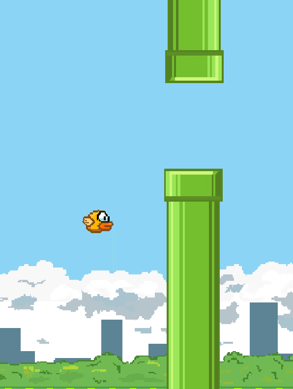

# FlappyBird-in-Opengl
The project involves creating a Flappy Bird-style game in OpenGL using C/C++.



# How to Compile
Open the CMD and run the CMake installation;
```bash
  winget install Kitware.CMake
```
Go to the project location;
Create a folder for the build;
```bash
  mkdir build && cd build
```
Compile the CMakeLists.txt;
```bash
  cmake .. && cmake --build . && cd Debug && FlappyBird.exe
```
